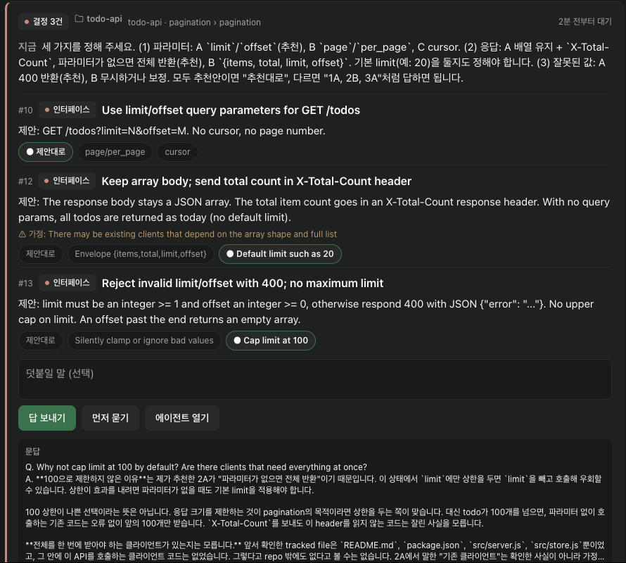
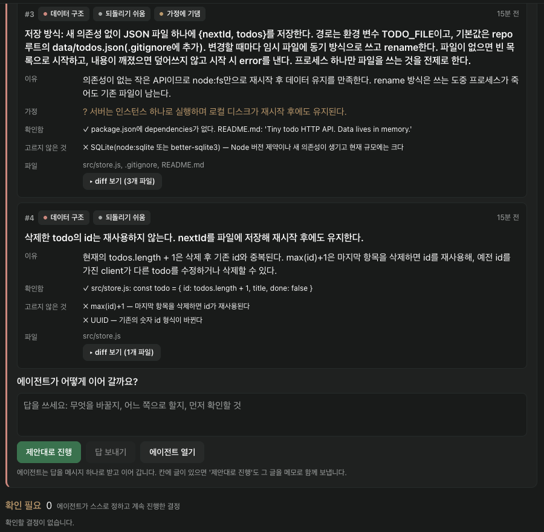
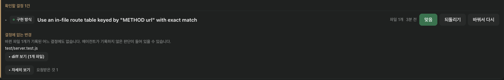
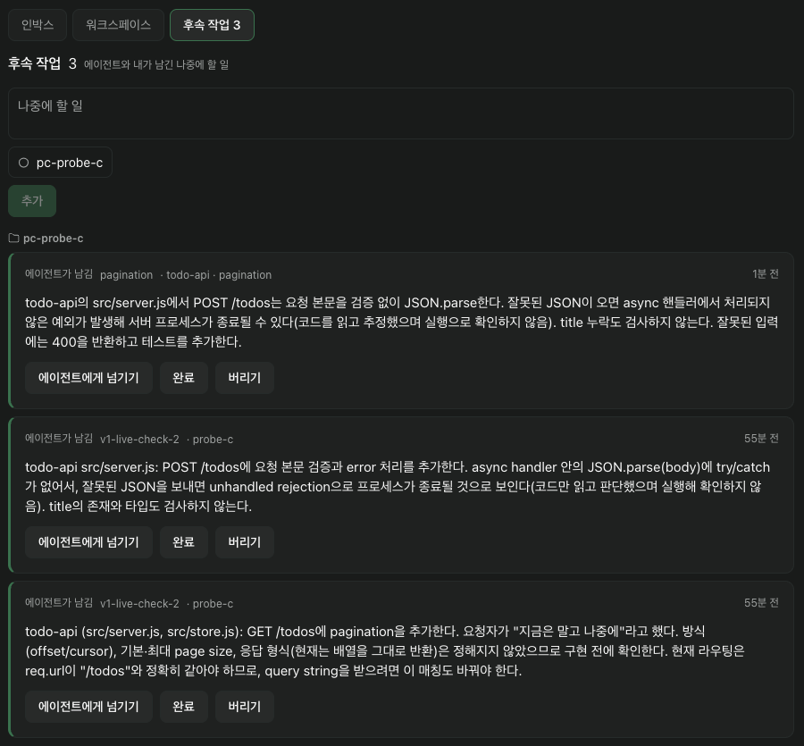

# Coordinator for Paseo

A [Paseo](https://paseo.sh) plugin for people who run many coding agents across many projects and workspaces. It watches the agents in the projects you choose and brings you only what needs a person, with the context to decide quickly: decisions an agent stopped on, permission requests, questions and errors. It also keeps a log of the decisions agents made on their own, each with its evidence, assumptions and diff, so you can check them in one place.

You still create workspaces, plan and direct the work. The coordinator does not split requests, start agents, merge pull requests or clean up branches.

[한국어 소개](OVERVIEW.ko.md)



## How it works

```
You start an agent in a watched project and give it work
  → The agent meets a choice your messages and the repository do not settle
  → It calls record_decision before acting: what, why, alternatives,
    evidence (checked or assumed), whether it rests on an assumption, how hard to undo, files
  → The plugin decides
      ├─ stop: scope, data shape, interface, user-visible behavior, hard to undo, or rests on an assumption
      │     → the agent asks about all stopped decisions at once (its question tool, or one message) and waits
      │     → a small model summarizes what led there and what each answer leads to
      │     → one card per agent in "Needs my decision"; your answer goes back as one message
      └─ continue: recorded, the agent goes on
            → grouped per workspace in "To review": "Looks right" or "Change it"
```

Work for later goes to the follow-up list through `add_followup` instead of being done now.

## Screens

**Inbox.** "Needs my decision" holds stopped decisions (one card per agent), permission requests, questions and errors. A stopped-decision card shows:

- the context summary: what led here, what to decide now, what each answer leads to, what to watch out for
- each decision with its reason, assumptions in warning color, checked evidence, alternatives not chosen, and its files with diffs
- an answer box, "Go ahead as proposed" and "Open agent"

<p>
  
  
</p>

If the agent asks with a question tool such as AskUserQuestion, the question's options take the place of the answer box in the same card, and the answer is recorded on the decisions.

"To review" groups the decisions agents made and kept going with, per workspace. The sidebar badge counts only what waits on you. Permission requests, questions and errors come from every agent on the host; decisions, summaries, pull request state and follow-ups cover the watched projects.

**Progress.** A table of every agent on the host. Each row is a workspace; the columns say how much it waits on you: needs my decision, to review, working, waiting. Each cell holds agent cards with the state, the last reply and the agent's decisions waiting or to review. Rows that wait on you come first. Rows of watched projects also show, under the workspace name:

- pull request state: checks, conflicts, review
- decisions waiting and decisions to review
- changed files that no decision covers (counted once the workspace has recorded decisions)
- files another workspace of the same project also changed

"Decisions and changes" opens the judgment trail under the row: what was asked, the decisions with their diffs, the changes no decision explains, and the overlaps. On a narrow screen each workspace becomes a card with its agents stacked.


**Follow-ups.** Work for later, from agents and from you, by project. Hand one to an agent in the same project (that closes it), mark it done or dismiss it.

**Settings.** Projects to watch, context summaries on or off with their model and effort, summary language, text size.

<p>
  
  
</p>

## Requirements

- Paseo 0.17.4 or later with plugins enabled. Tested on macOS with Claude agents.
- `git` in the watched projects. Pull request state comes from Paseo's GitHub integration; the plugin itself does not call GitHub.

## Install

```bash
paseo plugin install github:cyb9701/paseo-coordinator
```

## Setup

Open **Coordinator** from the sidebar, go to **Settings** and choose the projects to watch. Agents in those projects, including the ones you start yourself, get the decision tools and instructions when their session opens; sessions that are already open pick them up when they reopen. With no project chosen the plugin changes no session.

## What it reads, runs and stores

- State (decisions, follow-ups, summaries, messages waiting for a busy agent): `plugin-data/paseo-coordinator/state.json` under the Paseo home (`$PASEO_HOME` or `~/.paseo`).
- It reads each watched agent's messages to show what was asked and to build summaries.
- It runs read-only `git` commands (`rev-parse`, `merge-base`, `diff`, `ls-files`), at most four workspaces at a time, in watched workspaces. Diffs are shown only for files the workspace changed.
- A summary runs one background agent with the summary model (default `claude/claude-haiku-5-5`) in a single hidden workspace the plugin reuses, then archives the agent. With Claude its tools are removed; with any provider it runs in a mode that asks for permission, and the plugin denies every request. Summaries run only when an agent stops for your decision, a turn fails (at most once every 10 minutes per agent), or you ask for one; at most two run at once. Turning summaries off stops the automatic ones; the button on a card still works.
- Answers and instructions reach an agent only while it is idle, so they do not cut into a running turn.

- If the plugin restarts during a turn, decision tool calls in that turn fail; they are recorded from the agent's history when the turn ends or when the agent next asks a question.

See [OVERVIEW.md](OVERVIEW.md) for limits.

## Develop

```bash
npm install
npm run typecheck
npm test                                # server tests with a fake Paseo API and temporary git repositories
paseo plugin install /absolute/path/to/paseo-coordinator
paseo plugin reload paseo-coordinator   # after each change
```

No build step and no runtime dependencies beyond what Paseo provides. `npm test` covers the stop rule, decision paths, answering stopped decisions in one message, delivery only to idle agents, refusing to send to a gone agent, reviews and undo instructions, follow-ups, summary batching, the error-summary interval, summaries interrupted by a restart, answers given in a question window, tool calls lost to a restart, and, against real git worktrees, changed files, overlaps, non-ASCII names, a workspace in a repository subfolder, separate caches per project set and the diff path guard.

## Documents

- [OVERVIEW.md](OVERVIEW.md) / [OVERVIEW.ko.md](OVERVIEW.ko.md): what the plugin does, data and limits
- [RULES.md](RULES.md): what agents record and when they stop (Korean)
- [DESIGN.md](DESIGN.md): roles, screens, data and Paseo hooks (Korean)

## License

MIT
