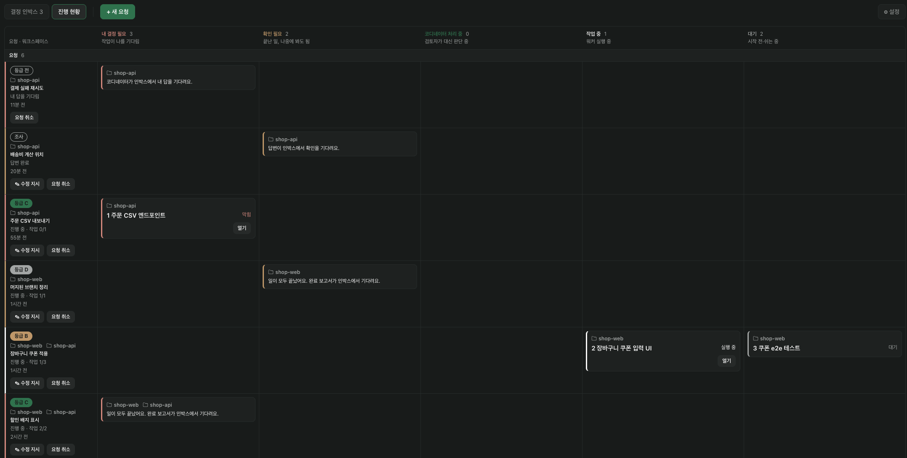
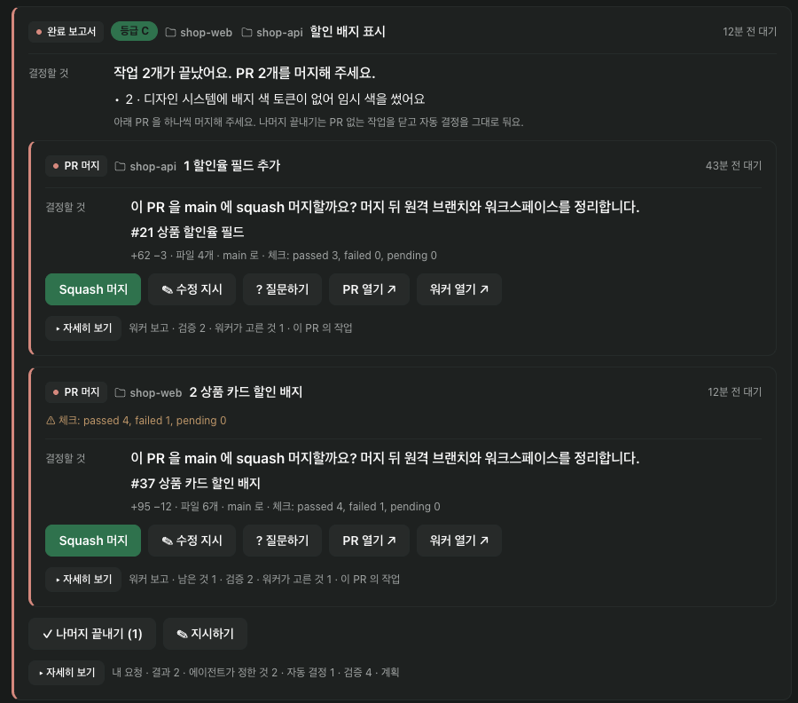

# Coordinator for Paseo

A [Paseo](https://paseo.sh) plugin that keeps you from becoming the bottleneck when many coding agents work at once. You write one request; a coordinator agent turns it into work for coding agents in the right projects, and only the decisions that need a person reach you.

[한국어 소개](OVERVIEW.ko.md)



*Progress board. Each request is a row; its tasks sit in the column that says who they are waiting on: you now, the coordinator and its reviewers, a worker, or nothing yet. A finished task leaves the columns, and when the whole request has nothing left to run its report shows up in "Needs my decision" or "To review". Agents you launched yourself get their own rows below. Each task shows its branch and worktree path.*

## How it works

```
You write a request
  → Coordinator agent reads it and the allowed projects
      ├─ answers questions about the code directly
      ├─ asks everything it needs from you once, on one question card, before it starts
      ├─ investigates first when it must; the report comes back to the coordinator,
      │     which asks you what to change (grade A) or plans it (grades B–D)
      └─ splits a change into tasks, grades it A (high risk) to D (simple), and starts workers right away
  → Each worker runs in its own git worktree and branch, or in a workspace of yours that you chose
      ├─ needs a decision → report_blocker
      │     ├─ settled by your request or the repo's conventions → coordinator proposes an answer,
      │     │     2–3 fresh reviewer agents that cannot edit files check it, all must pass → sent to the worker
      │     └─ otherwise → a decision card for you
      ├─ code task done → verifies and commits; in a new worktree it also pushes and opens a pull request; report_done
      └─ operation task done → acted only on the targets you approved, report_done (no pull request)
  → Nothing left to run → one report for the whole request
      ├─ pull requests to merge → you squash-merge each from the report, exactly the commit it shows;
      │     the plugin deletes the branch and archives the workspace
      └─ nothing to merge → "Finish" closes the request and cleans up
```

A request that asks for a change never ends as just a report:

- **Investigations come back.** When a change needs an investigation first, its report goes back to the coordinator instead of becoming an answer you confirm and close. The same happens when you write to a request while its investigation runs.
- **Grade A waits for you.** The real change starts only after you answer a question card written from the investigation.
- **Operation tasks.** Work outside a worktree, such as deleting branches or worktrees, deleting a remote branch or running an app, lists exactly what it touches. It starts only after you answer a question card whose questions or options show that list, and after the work it depends on is settled: its pull request merged or its report item closed. Until then the report shows that it starts after the merge.
- **Instructions while it runs.** Send them from the request on the progress board or from its report. The coordinator passes them to the workers, adds tasks or drops unfinished ones, and asks you first when they go beyond the request.
- **Automatic answers.** They stop for a rule for the rest of a request after you revert one, and everywhere after you revert two of its last ten. You can switch them off in settings.

## Decision inbox

The coordinator asks what it needs once, before it starts, and tells you once, when nothing is left to run. Starting a request, each finished task and each automatic decision no longer get a card of their own.

| Needs my decision (work is waiting on you) | To review (finished work) |
| --- | --- |
| Questions from the coordinator, including approving operation tasks | Answers to read-only requests |
| Worker questions that need a person, and answers that failed independent review | Reports with nothing to decide: every task finished without a pull request, or committed in your workspace |
| Reports with pull requests to merge or work left outside a pull request | |
| Stopped tasks (restart or cancel), a stopped coordinator, permission requests | |

A report shows up when the request has nothing left to run: no worker working, no blocked task, no task about to start, no open question. It lists the result of every task, what is left for you (pull requests to merge, commits in your workspace, tasks that start after a merge, work the workers left), what the agents decided on their own (worker choices and automatic answers, which you can still revert), and, folded, the verification and the plan. Each pull request to merge sits inside the report with its own merge card. "Finish" closes the rest in one go.

The sidebar badge counts only the left column. Buttons say what they do: "End with this answer" closes a read request, "Finish" closes a report. Canceling a request asks first, and is refused while finished work still waits on a decision card. If the coordinator itself stops (it cannot be reached, or keeps ignoring what it was sent), a "Coordinator stopped" card shows why and lets you try again.

<p>
  
  
</p>

A card shows only what to decide and its buttons: the actual question, its options with the recommended one marked and a one-line risk each. Everything else (your request, the situation, the worker's report, verification, the worker's choices, how to undo each option) sits under **Details**, folded, with the names of its sections next to the button. Warnings you must not miss stay outside: reviewer objections, pull request conflicts or failing checks, work left outside a pull request. So do an answer's text, the command a permission request would run, and the targets of an operation you approve. You can pick the recommendation, write your own instruction, or ask the coordinator first; the questions and answers stay in the task's decision record.

<p>
  
  
</p>

*Left: a worker question that independent review sent to you. Right: a request's report with two pull requests to merge; one has a failing check, so its warning stays outside the folded details.*

## Requirements

- Paseo 0.17.4 or later with plugins enabled. Tested on macOS.
- A provider for the coordinator and workers. Every agent runs in auto mode. Reviewers need a provider that also has a read-only mode (today Claude); their editing tools are removed and they run at high effort or above.
- The GitHub CLI (`gh`), installed and signed in, and a GitHub remote on each project. The plugin uses it to find the task branch's pull request, merge it when you press merge, and delete the branch.
- Optional: the pstack Claude plugin. Grade A, B and C change workers then start with `/poteto-mode`. You can turn this off in settings.

## Install

```bash
paseo plugin install github:cyb9701/paseo-coordinator
```

A registry listing is under review ([getpaseo/plugins#3341](https://github.com/getpaseo/plugins/issues/3341)).

## Setup

Open **Coordinator** from the sidebar. The badge counts cards that need your decision.


Go to **Settings** (top right):

1. Choose the projects the coordinator may use. With none selected it starts no workers.
2. Pick the model and effort for the coordinator, the workers and the reviewers, and optionally a base branch per project.
3. Choose whether workers use `/poteto-mode`, whether the coordinator may answer workers automatically after independent review, and the output language for workspace names and cards.


Then press **+ New request**, describe what you want, and optionally pick projects and a done criterion. Leave projects empty to let the coordinator choose among the allowed ones.

For each project you pick, choose where workers work:

- **New worktree · new branch** (default). Each task gets its own worktree and a new branch. The branch starts from the branch the coordinator picks when the request builds on unmerged work, otherwise the per-project base in settings, otherwise the remote default branch. To start from a particular branch, say so in the request. Workers open pull requests against that base.
- **One of your open workspaces.** Workers continue there in a new session, on the branch checked out there. Code tasks only commit; you push and merge that branch your own way. A task waits while the workspace has uncommitted changes, another agent works in it, or another unfinished task still uses it. Finishing it from the report closes only the worker's session.

The coordinator can also propose one of your workspaces, but only after you approve its directory, written in a question or option of a question card, and never one on the default branch for code tasks.


Every agent runs in Claude auto mode: the coordinator, workers (investigations included) and reviewers. The coordinator has every built-in tool that reads, edits or runs commands removed, and works only through its own tools; reviewers have the editing tools removed. Your Claude permission rules still decide which worker commands ask you. Add `ask` rules for anything you want to see first, such as `Bash(gh pr merge *)`. Code workers are told never to merge, deploy, write to databases or push to other branches, and to report such needs instead; operation workers may act outside their worktree only on the targets you approved. Worker commands do not pass through the plugin, so those rules and your permission rules are what stop a command.

## What it stores and reads

- Requests, plans, decisions and card history: `plugin-data/paseo-coordinator/state.json` under the Paseo home (`$PASEO_HOME` or `~/.paseo`).
- The coordinator reads files only inside allowed projects, through its own read-only tools. Secret files such as `.env`, keys and credentials, and anything under `.git`, are refused.
- All agents run on your own providers and accounts, so every request uses model time and tokens. Each automatic decision adds two or three reviewer agents.
- When a read request is confirmed or an investigation is replaced by a plan, the plugin archives the investigation workspaces. When a task closes, it deletes the task's local branch only if every commit on it is on a remote.

See [OVERVIEW.md](OVERVIEW.md) for the full list and known limits.

## Develop

```bash
npm install
npm run typecheck
npm test                                # server flow tests, no Paseo needed
paseo plugin install /absolute/path/to/paseo-coordinator
paseo plugin reload paseo-coordinator   # after each change
```

The plugin has no build step and no runtime dependencies beyond what Paseo provides. `npm test` runs the server code against a fake Paseo API and temporary git repositories: review failures and timeouts, auto-stop, races between hooks and the reconcile pass, dispatch during cancel, merge-card flows, investigations returning to the coordinator, when a request's report appears, the grade A, operation-task and existing-workspace gates (targets must be in a question or option, not only the folded background), the tools removed from the coordinator and reviewers, adding and canceling tasks, honest reverts, replaying a report whose tool call failed, coordinator stalls, base branches, and merging only what the card showed (with a fake `gh`).

## Documents

- [OVERVIEW.md](OVERVIEW.md) / [OVERVIEW.ko.md](OVERVIEW.ko.md): what the plugin does, setup, data and limits
- [RULES.md](RULES.md): when the coordinator may decide without you, and the A–D grades (Korean)
- [DESIGN.md](DESIGN.md): screens, cards and data flow (Korean)
- [PLAN.md](PLAN.md): implementation phases (Korean)

## License

MIT
