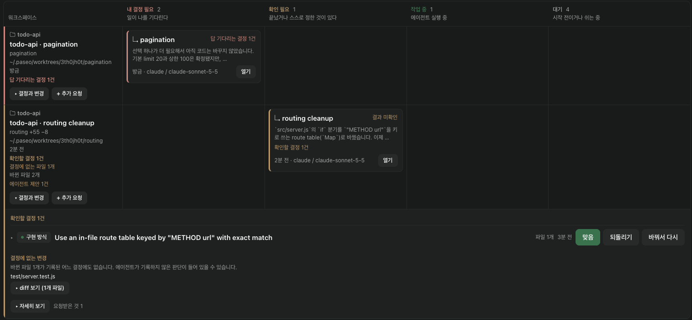
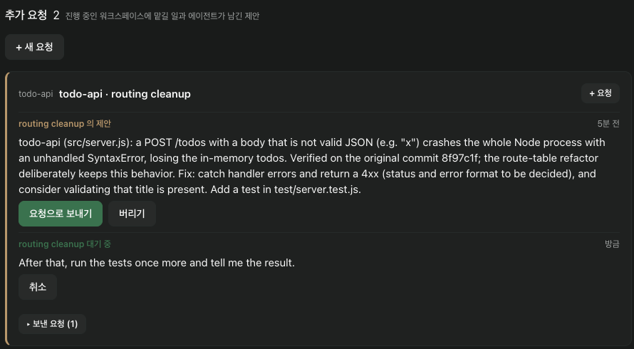
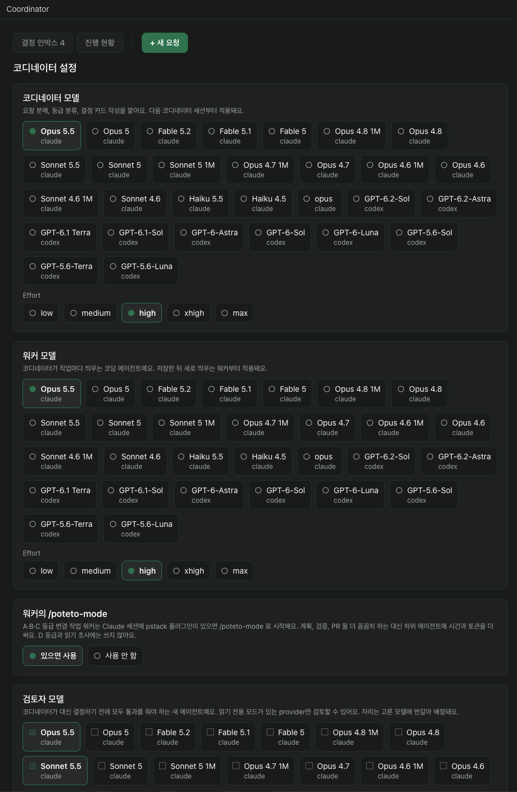

# Coordinator for Paseo

A [Paseo](https://paseo.sh) plugin for people who run many coding agents across many projects and workspaces. It watches the agents in the projects you choose and brings you only what needs a person, with the context to decide quickly: decisions an agent stopped on, permission requests, questions and errors. It also keeps a log of the decisions agents made on their own, each with its evidence, assumptions and diff, so you can check them in one place.

A coordinator session, working only when you press a button, reads the conversations, marks the sessions waiting on you with a one-sentence question and a reply you can send, answers purely factual questions for you and checks the work reports agents leave.

You still create workspaces, plan and direct the work. The coordinator does not split requests, start worker agents, approve or choose for you, merge pull requests or clean up branches.

[한국어 소개](OVERVIEW.ko.md)



## How it works

```
You start an agent in a watched project and give it work
  → The agent meets a choice your messages and the repository do not settle
  → It calls record_decision before acting: a one-line title, what, why, alternatives,
    evidence (checked or assumed), whether it rests on an assumption, how hard to undo, files
  → The plugin decides
      ├─ stop: scope, data shape, interface, user-visible behavior, hard to undo, or rests on an assumption
      │     → the agent asks about all stopped decisions at once (its question tool, or one message) and waits
      │     → one short card per agent in "Needs my decision"; your answer goes back as one message
      └─ continue: recorded, the agent goes on
            → one line per decision to review: Looks right, Revert, or Redo differently
```

Work outside the request goes to the request list as a suggestion through `add_followup` instead of being done now. When an agent finishes or gets blocked it reports once through `report_work`, with its evidence.

### Question finder

Cards come from signals first. When an agent in a watched project ends a turn with no card (no permission request, question window, error, stopped decision or open report), a one-off question finder agent reads that session and records a judgment: a question card with a reply you can send, a result to check, or nothing. It only makes cards and never messages the agent. If the conversation moves on while it judges, the result is dropped. It is always on.

### The coordinator session

```
You press "Request digest"
  → a fresh coordinator session starts in its own workspace (project "coordinator");
    the previous one is archived so old digests do not pile up in its context
  → it reviews open work reports against each agent's conversation (verified ones close)
  → it reads each idle session in the watched projects and records a judgment:
      ├─ question: one sentence on what you must decide, plus a reply you can edit and send
      ├─ review: what to check
      └─ idle: nothing due
  → a purely factual question (which branch, which file, PR state) gets an answer from it,
    only within that digest, marked as information and not your decision
```

While it works the button reads "Digest running…" and another request is refused. It never wakes up on its own, uses only its four board tools (every other permission request is denied), and never approves, chooses between options, grants permissions or accepts work.

## Screens

**Inbox.** The coordinator sits at the top: request a digest, message it, open it, and see the factual answers it gave. "Needs my decision" holds stopped decisions (one card per agent), permission requests, questions, errors and the sessions the question finder or the coordinator found waiting on you. A stopped-decision card stays short:

- one line on what to decide now, from a small-model summary
- each decision as a title, the agent's proposal in two lines, a warning line if it rests on an assumption, and its alternatives as chips
- a note box and one button: "Go ahead as proposed", or "Send answer" once you pick an alternative or write a note
- "Ask first" to ask the agent before deciding; the question and its answer stay on the card
- the full context, evidence and diffs folded under Details

If the agent asks with a question tool such as AskUserQuestion, its options take the place of the chips and the answer is recorded on the decisions.

"To review" lists results the question finder or the coordinator says to check, work reports it could not confirm, and, per workspace, the decisions agents made and kept going with, one line each. The sidebar badge counts only what waits on you. Permission requests, questions and errors come from every agent on the host; decisions, summaries and pull request state cover the watched projects.

<p>
  
  
</p>

**Progress.** A table of every agent on the host. Each row is a workspace; the columns say how much it waits on you: needs my decision, to review, working, waiting. Each cell holds agent cards with the state, the last reply and the agent's decisions waiting or to review. Rows that wait on you come first. Rows of watched projects also show pull request state, decisions waiting and to review, changed files no decision covers (once the workspace has recorded decisions) and files another workspace also changed.

- "Decisions and changes" opens the workspace's decisions under the row, one line each: status, kind, title, an assumption mark, file count and time. Open a line for the reason, evidence, alternatives and diff. Each line has "Looks right", "Revert" (undo what that decision changed) and "Redo differently" (tell the agent how instead). Changes no decision explains and overlapping files follow.
- "Request" gives the workspace more work. The agent there gets it right away if it is idle, or when its turn ends.


**Requests.** Extra work for running workspaces, by workspace: requests waiting for a busy agent (cancel them before they are sent), suggestions agents left through `add_followup` (send one as a request or dismiss it), and requests already sent.

**Settings.** Projects to watch, context summaries on or off with their model and effort, the coordinator model and effort (also used by the question finder), the language of summaries and the coordinator, text size.

<p>
  
  
</p>

## Requirements

- Paseo 0.17.4 or later with plugins enabled. Tested on macOS with Claude agents.
- `git` in the watched projects. Pull request state comes from Paseo's GitHub integration; the plugin itself does not call GitHub.

## Install

```bash
paseo plugin install github:cyb9701/paseo-coordinator
```

## Setup

Open **Coordinator** from the sidebar, go to **Settings** and choose the projects to watch. Agents in those projects, including the ones you start yourself, get the decision tools and instructions when their session opens; sessions that are already open pick them up when they reopen. With no project chosen the plugin changes no session.

## What it reads, runs and stores

- State (decisions, requests, questions you asked agents, summaries, coordinator judgments, factual answers and work reports, messages waiting for a busy agent): `plugin-data/paseo-coordinator/state.json` under the Paseo home (`$PASEO_HOME` or `~/.paseo`), readable only by your account.
- It reads each watched agent's messages to show what was asked and to build summaries.
- It runs read-only `git` commands (`rev-parse`, `merge-base`, `diff`, `ls-files`), at most four workspaces at a time, in watched workspaces. Diffs are shown only for files the workspace changed.
- The coordinator session runs with the coordinator model (default `claude/claude-sonnet-5-5`) in a mode that asks for permission. With Claude its four tools are on the allowed list; the plugin denies every other request, and with Claude its file and shell tools are removed. During a digest it reads the recent conversation of each idle session in the watched projects.
- The question finder runs one hidden agent with the coordinator model in the coordinator's workspace for each turn that ends with no card, then archives it; at most two run at once, with no tools.
- A summary runs one hidden agent with the summary model (default `claude/claude-haiku-5-5`) in the coordinator's workspace, then archives the agent. With Claude its tools are removed; with any provider it runs in a mode that asks for permission, and the plugin denies every request. Summaries run only when an agent stops for your decision, a turn fails (at most once every 10 minutes per agent), or you ask for one; at most two run at once. Turning summaries off stops the automatic ones; the button on a card still works.
- Answers and instructions reach an agent only while it is idle, so they do not cut into a running turn.

- If the plugin restarts during a turn, decision tool calls in that turn fail; they are recorded from the agent's history when the turn ends or when the agent next asks a question.

See [OVERVIEW.md](OVERVIEW.md) for limits.

## Develop

```bash
npm ci
npm run typecheck
npm test                                # server and screen-logic tests with a fake Paseo API and temporary git repositories
paseo plugin install /absolute/path/to/paseo-coordinator
paseo plugin reload paseo-coordinator   # after each change
```

No build step and no runtime dependencies beyond what Paseo provides. `npm test` covers the stop rule, decision paths, answering stopped decisions in one message, delivery only to idle agents, refusing to send to a gone agent, reviews and undo instructions, requests and suggestions, revert and redo, asking first, coordinator listing, judgments with stale or missing evidence, factual answers only inside a requested digest, report reviews, judgment replies, the question finder (only for turns without a card, dropped when the conversation moves on), summaries in the coordinator workspace, summary batching, the error-summary interval, summaries interrupted by a restart, answers given in a question window, tool calls lost to a restart, and, against real git worktrees, changed files, overlaps, non-ASCII names, a workspace in a repository subfolder, separate caches per project set and the diff path guard. `test/client.test.ts` covers the screen logic kept out of `.tsx` files: badge and inbox counts (including coordinator judgments and reports), row columns and order, request recipients, which summary a card shows, previews and host-scoped refs.

Releases are the `vX.Y.Z` git tags the release workflow creates from conventional commits; `package.json` keeps `0.0.0`. Pull requests run typecheck and tests (`.github/workflows/verify.yml`) before anything reaches `main`, which is what users install.

## Documents

- [OVERVIEW.md](OVERVIEW.md) / [OVERVIEW.ko.md](OVERVIEW.ko.md): what the plugin does, data and limits
- [RULES.md](RULES.md): what agents record and when they stop (Korean)
- [DESIGN.md](DESIGN.md): roles, screens, data and Paseo hooks (Korean)

## License

MIT
