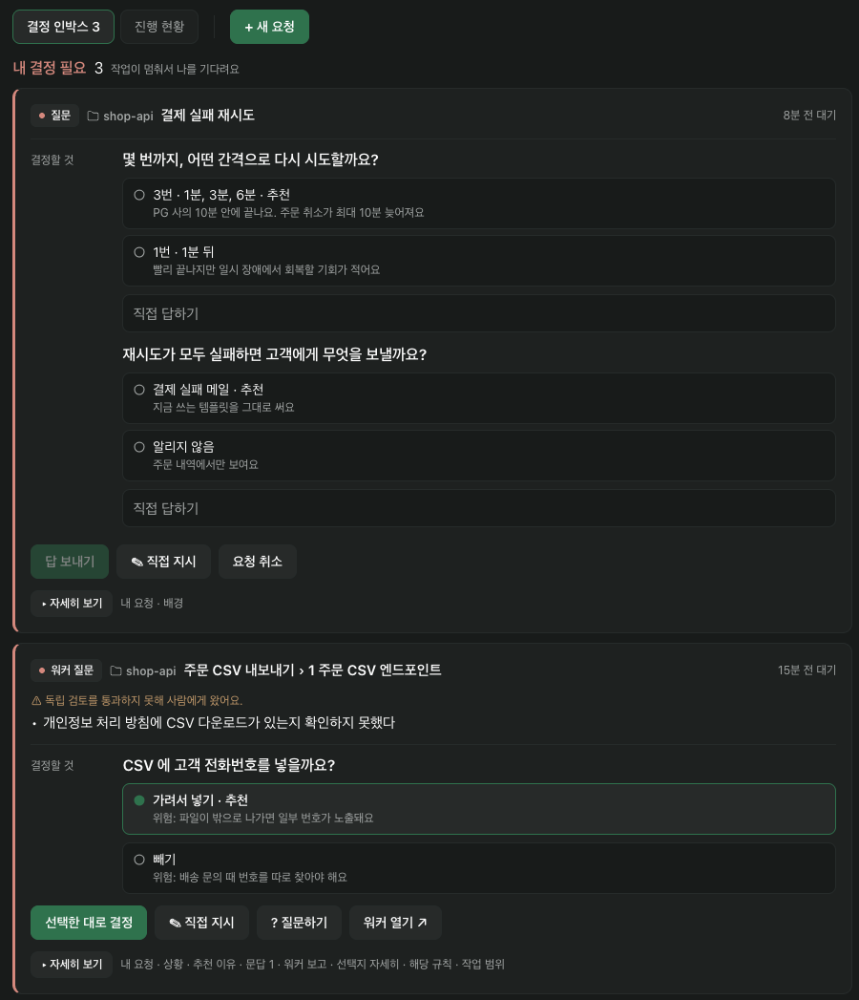
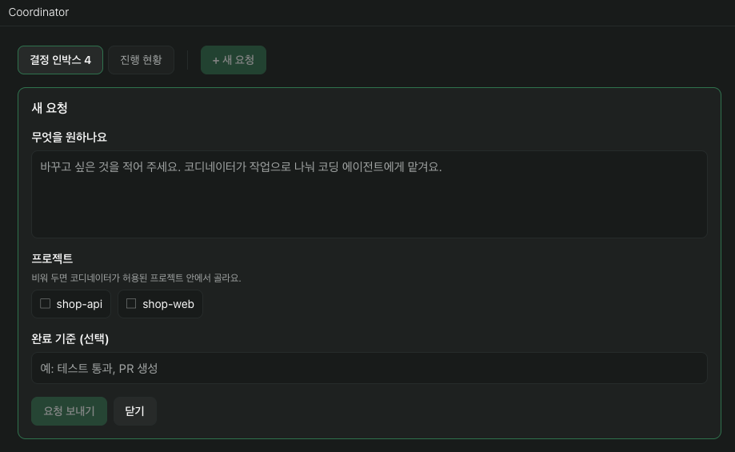

# Coordinator for Paseo

A [Paseo](https://paseo.sh) plugin that keeps you from becoming the bottleneck when many coding agents work at once. You write one request; a coordinator agent turns it into work for coding agents in the right projects, and only the decisions that need a person reach you.

[한국어 소개](OVERVIEW.ko.md)


*Progress board. Each request is a row; its tasks sit in the column that says who they are waiting on: you, the coordinator and its reviewers, a worker, or nothing yet.*

## How it works

```
You write a request
  → Coordinator agent reads it and the allowed projects
      ├─ answers questions about the code directly
      ├─ asks you when the request can be read more than one way
      ├─ investigates first when it must; the report comes back to the coordinator,
      │     which asks you what to change (grade A) or plans it (grades B–D)
      └─ splits a change into tasks, grades it A (high risk) to D (simple), and starts workers
  → Each worker runs in its own git worktree and branch
      ├─ needs a decision → report_blocker
      │     ├─ settled by your request or the repo's conventions → coordinator proposes an answer,
      │     │     2–3 fresh read-only reviewer agents check it, all must pass → sent to the worker
      │     └─ otherwise → a decision card for you
      ├─ code task done → verifies, pushes, opens a pull request, report_done
      └─ operation task done → acted only on the targets you approved, report_done (no pull request)
  → Merge card: you squash-merge; the plugin deletes the branch and archives the workspace
  → Finished without a pull request and nothing left behind: a card to review later
```

A request that asks for a change never ends as just a report:

- **Investigations come back.** When a change needs an investigation first, its report goes back to the coordinator instead of becoming an answer you confirm and close. The same happens when you write to a request while its investigation runs.
- **Grade A waits for you.** The real change starts only after you answer a question card written from the investigation.
- **Operation tasks.** Work outside a worktree, such as deleting branches or worktrees, deleting a remote branch or running an app, lists exactly what it touches. It starts only after you answer a question card that shows that list, and after the pull requests it depends on are merged.
- **Instructions while it runs.** Send them from the start card or the request on the progress board. The coordinator passes them to the workers, adds tasks or drops unfinished ones, and asks you first when they go beyond the request.
- **Automatic answers.** They stop for a rule for the rest of a request after you revert one, and everywhere after you revert two of its last ten. You can switch them off in settings.

## Decision inbox

| Needs my decision (work is waiting on you) | To review (work continues) |
| --- | --- |
| Questions from the coordinator, including approving operation tasks | Requests the coordinator started on its own |
| Worker questions that need a person | Answers to read-only requests |
| Answers that failed independent review | Decisions made automatically after review |
| Pull requests to merge, and finished work left outside a pull request | Tasks that finished without a pull request and left nothing behind |
| Stopped tasks (restart or cancel), a stopped coordinator, permission requests | |

The sidebar badge counts only the left column. Buttons say what they do: "End with this answer" closes a read request, "Seen, keep going" leaves a started request running, and "Finish · clean up" closes a task without a pull request. "Mark all reviewed" handles the right column in one go but skips answers, because confirming an answer ends its request. If the coordinator itself stops (it cannot be reached, or keeps ignoring what it was sent), a "Coordinator stopped" card shows why and lets you try again.

*The screenshots below were taken before the left column was renamed from "Needs reaction" to "Needs my decision".*

<p>
  
  
</p>

Every card reads top to bottom: your request and what is happening, anything to check (reviewer objections, assumptions, work left), then the decision with its options and buttons. The decision is the actual question, with the recommended option marked and a one-line risk for each option. Evidence such as the worker's full report, verification, choices the worker made and how to undo each option sits under **Details**, folded, with the names of its sections next to the button. You can pick the recommendation, write your own instruction, or ask the coordinator first; the questions and answers stay in the task's decision record.

<p>
  
  
</p>

*Left: a worker question that needs a person, with a question you already asked the coordinator. Right: a finished task waiting for you to merge its pull request.*

## Requirements

- Paseo 0.17.4 or later with plugins enabled. Tested on macOS.
- A provider for the coordinator and workers. Reviewers need a provider with a read-only mode; today that is Claude (plan mode), at high effort or above.
- The GitHub CLI (`gh`), installed and signed in, and a GitHub remote on each project. The plugin uses it to find the task branch's pull request, merge it when you press merge, and delete the branch.
- Optional: the pstack Claude plugin. Grade A, B and C change workers then start with `/poteto-mode`. You can turn this off in settings.

## Install

```bash
paseo plugin install github:cyb9701/paseo-coordinator
```

A registry listing is under review ([getpaseo/plugins#3341](https://github.com/getpaseo/plugins/issues/3341)).

## Setup

Open **Coordinator** from the sidebar. The badge counts cards that need your decision.


Go to **Settings** (top right):

1. Choose the projects the coordinator may use. With none selected it starts no workers.
2. Pick the model and effort for the coordinator, the workers and the reviewers.
3. Choose whether workers use `/poteto-mode`, whether the coordinator may answer workers automatically after independent review, and the output language for workspace names and cards.


Then press **+ New request**, describe what you want, and optionally pick projects and a done criterion. Leave projects empty to let the coordinator choose among the allowed ones. For each project you pick you can also choose the base branch: workers branch off it and open pull requests against it. Pick the feature branch when the request builds on work that is not merged yet; otherwise the coordinator decides, then the per-project base in settings, then the remote default branch.



Change workers run in Claude auto mode, so your Claude permission rules still decide which commands ask you. Add `ask` rules for anything you want to see first, such as `Bash(gh pr merge *)`. Code workers are told never to merge, deploy, write to databases or push to other branches, and to report such needs instead; operation workers may act outside their worktree only on the targets you approved. Worker commands do not pass through the plugin, so those rules and your permission rules are what stop a command.

## What it stores and reads

- Requests, plans, decisions and card history: `plugin-data/paseo-coordinator/state.json` under the Paseo home (`$PASEO_HOME` or `~/.paseo`).
- The coordinator reads files only inside allowed projects, through its own read-only tools. Secret files such as `.env`, keys and credentials, and anything under `.git`, are refused.
- All agents run on your own providers and accounts, so every request uses model time and tokens. Each automatic decision adds two or three reviewer agents.
- When a read request is confirmed or an investigation is replaced by a plan, the plugin archives the investigation workspaces. When a task closes, it deletes the task's local branch only if every commit on it is on a remote.

See [OVERVIEW.md](OVERVIEW.md) for the full list and known limits.

## Develop

```bash
npm install
npm run typecheck
npm test                                # server flow tests, no Paseo needed
paseo plugin install /absolute/path/to/paseo-coordinator
paseo plugin reload paseo-coordinator   # after each change
```

The plugin has no build step and no runtime dependencies beyond what Paseo provides. `npm test` runs the server code against a fake Paseo API and temporary git repositories: review failures and timeouts, auto-stop, races between hooks and the reconcile pass, dispatch during cancel, merge-card flows, investigations returning to the coordinator, the grade A and operation-task gates, adding and canceling tasks, honest reverts, replaying a report whose tool call failed, and coordinator stalls.

## Documents

- [OVERVIEW.md](OVERVIEW.md) / [OVERVIEW.ko.md](OVERVIEW.ko.md): what the plugin does, setup, data and limits
- [RULES.md](RULES.md): when the coordinator may decide without you, and the A–D grades (Korean)
- [DESIGN.md](DESIGN.md): screens, cards and data flow (Korean)
- [PLAN.md](PLAN.md): implementation phases (Korean)

## License

MIT
