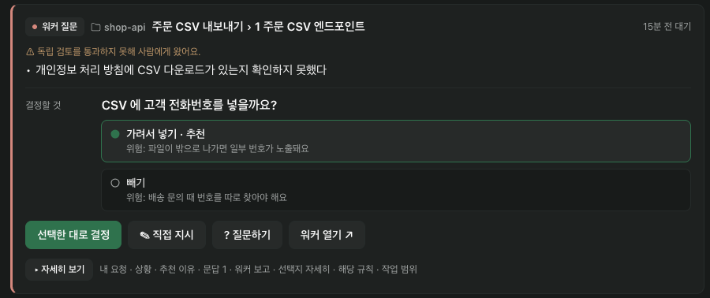

# Coordinator for Paseo

A [Paseo](https://paseo.sh) plugin that keeps you from becoming the bottleneck when many coding agents work at once. You write one request; a coordinator agent turns it into work for coding agents in the right projects, and only the decisions that need a person reach you.

[한국어 소개](OVERVIEW.ko.md)

<p>
  
  
</p>

*Left: a merge card after a worker finished. Right: a worker question that needed a person.*

## How it works

```
You write a request
  → Coordinator agent reads it and the allowed projects
      ├─ answers questions about the code directly
      ├─ asks you when the request can be read more than one way
      └─ splits a change into tasks, grades it A (high risk) to D (simple), and starts workers
  → Each worker runs in its own git worktree and branch
      ├─ needs a decision → report_blocker
      │     ├─ settled by your request or the repo's conventions → coordinator proposes an answer,
      │     │     2–3 fresh read-only reviewer agents check it, all must pass → sent to the worker
      │     └─ otherwise → a decision card for you
      └─ done → verifies, pushes, opens a pull request, report_done
  → Merge card: you squash-merge; the plugin deletes the branch and archives the workspace
```

Grade A changes always wait for you. Automatic answers for a rule stop after you revert two of its last ten.

## Decision inbox

| Needs reaction (work is waiting on you) | To review (work continues) |
| --- | --- |
| Questions from the coordinator | Requests the coordinator started on its own |
| Worker questions that need a person | Answers to read-only requests |
| Answers that failed independent review | Decisions made automatically after review |
| Pull requests to merge | |
| Stopped tasks, permission requests and errors | |

Every card reads top to bottom: your request, the task, what was found, the recommendation with evidence, risks and how to undo it, then the decision and its buttons. You can pick the recommendation, write your own instruction, or ask the coordinator first; the questions and answers stay in the task's decision record.

The progress board shows each request as a row, with columns ordered by how much they wait on you.

## Requirements

- Paseo 0.17.4 or later with plugins enabled. Tested on macOS.
- A provider for the coordinator and workers. Reviewers need a provider with a read-only mode; today that is Claude (plan mode), at high effort or above.
- The GitHub CLI (`gh`), installed and signed in, and a GitHub remote on each project. The plugin uses it to find the task branch's pull request, merge it when you press merge, and delete the branch.
- Optional: the pstack Claude plugin. Grade A, B and C change workers then start with `/poteto-mode`. You can turn this off in settings.

## Install

```bash
paseo plugin install github:cyb9701/paseo-coordinator
```

A registry listing is under review ([getpaseo/plugins#3341](https://github.com/getpaseo/plugins/issues/3341)).

## Setup

Open the Coordinator screen from the sidebar and go to **Settings** (top right):

1. Choose the projects the coordinator may use. With none selected it starts no workers.
2. Pick the model and effort for the coordinator, the workers and the reviewers.
3. Choose whether workers use `/poteto-mode`, and the output language for workspace names and cards.

Change workers run in Claude auto mode, so your Claude permission rules still decide which commands ask you. Add `ask` rules for anything you want to see first, such as `Bash(gh pr merge *)`. Workers are told never to merge, deploy, write to databases or push to other branches, and to report such needs instead.

## What it stores and reads

- Requests, plans, decisions and card history: `plugin-data/paseo-coordinator/state.json` under the Paseo home (`$PASEO_HOME` or `~/.paseo`).
- The coordinator reads files only inside allowed projects, through its own read-only tools. Secret files such as `.env`, keys and credentials, and anything under `.git`, are refused.
- All agents run on your own providers and accounts, so every request uses model time and tokens. Each automatic decision adds two or three reviewer agents.

See [OVERVIEW.md](OVERVIEW.md) for the full list and known limits.

## Develop

```bash
npm install
npm run typecheck
paseo plugin install /absolute/path/to/paseo-coordinator
paseo plugin reload paseo-coordinator   # after each change
```

The plugin has no build step and no runtime dependencies beyond what Paseo provides.

## Documents

- [OVERVIEW.md](OVERVIEW.md) / [OVERVIEW.ko.md](OVERVIEW.ko.md): what the plugin does, setup, data and limits
- [RULES.md](RULES.md): when the coordinator may decide without you, and the A–D grades (Korean)
- [DESIGN.md](DESIGN.md): screens, cards and data flow (Korean)
- [PLAN.md](PLAN.md): implementation phases (Korean)

## License

MIT
